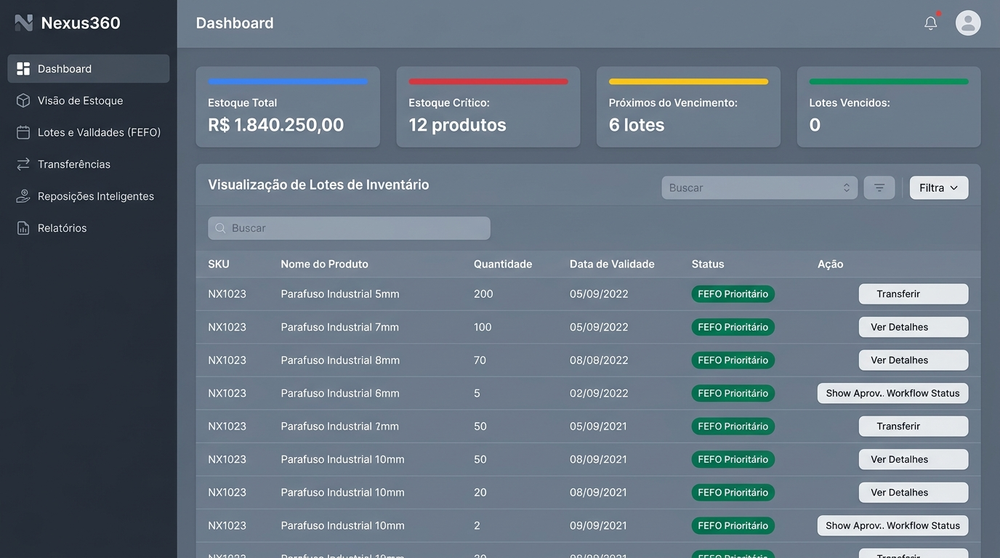
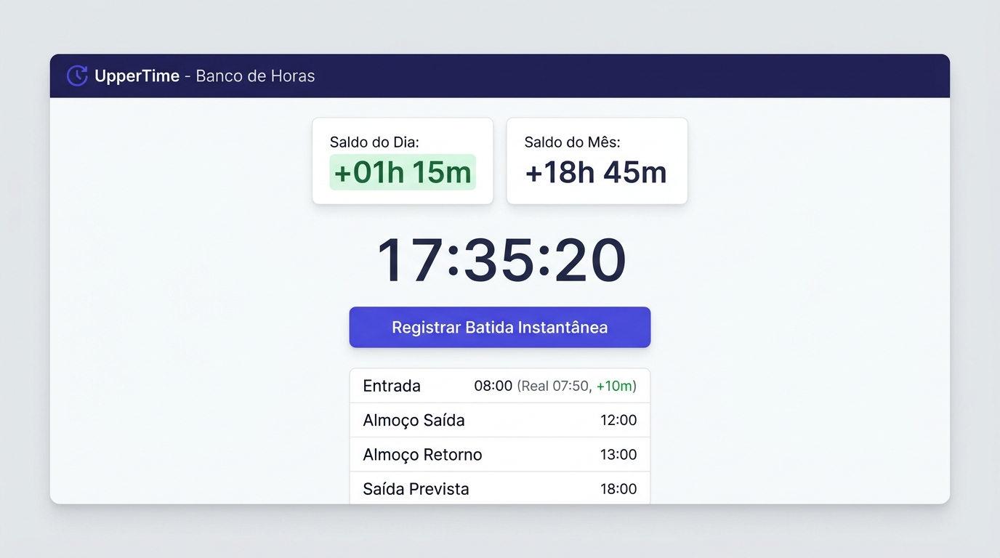
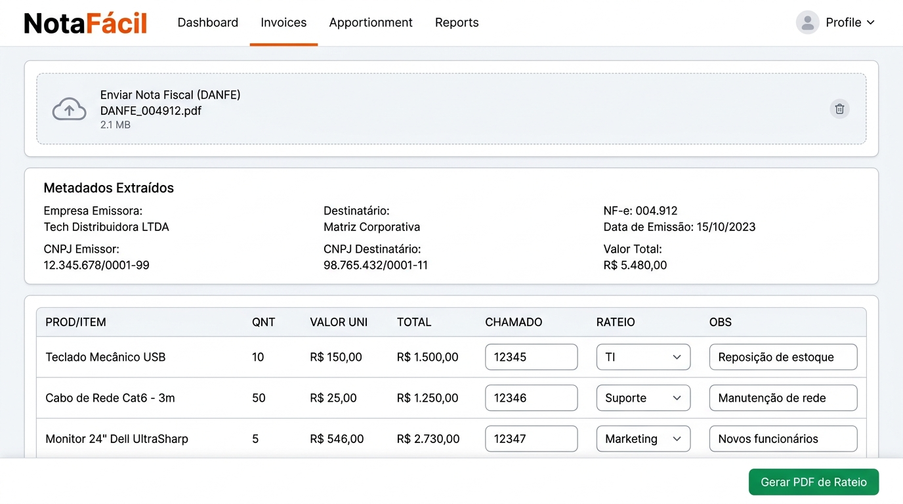

# Olá, eu sou o Daniel Martins 👋
### **Analista de TI & Desenvolvedor Full Stack | Automação com IA**

[-059669?style=for-the-badge&logo=googletranslate&logoColor=white)](#)

  

---

## 👨‍💻 Sobre Mim

Sou graduando do **8º semestre de Sistemas de Informação** na Faculdade UniFTC e atuo como **Analista de T.I no Grupo Itadil**. Tenho sólida vivência em diagnóstico de falhas, infraestrutura, suporte a sistemas corporativos e otimização de processos com desenvolvimento de software e automação inteligente.

- 🔭 **Foco de Atuação:** Construção de aplicações web modernas, dashboards corporativos, arquiteturas escaláveis e automação de fluxos técnicos utilizando **IA Aplicada** e engenharia de prompts.
- 💼 **Experiência Profissional:** Vivência corporativa prática em ambientes dinâmicos de TI, alinhando suporte técnico de alto nível, visão de processos e criação de ferramentas sob medida.
- 🌐 **Idiomas:** Inglês Avançado (**C1** - apto para times e documentação internacional) e Espanhol Básico (**A2**).
- 🎯 **Diferenciais:** Perfil analítico, proativo, com visão comercial e forte habilidade na resolução de problemas complexos.

---

## 🚀 Projetos em Destaque

Aqui estão alguns dos principais sistemas desenvolvidos para resolver problemas reais de gestão, produtividade e auditoria corporativa:

---

### 1. 📦 [Nexus360 - Gestão Integrada de Estoque & WMS](https://github.com/danmrtx/nexus360)

> **Sistema corporativo moderno para gestão de estoques de alta rotatividade, controle de perdas e automação logística para redes de varejo e centros de distribuição.**

  

- **O Problema Resolvido:** Redução drástica de prejuízos causados por produtos vencidos e gargalos de reposição entre filiais e matriz.
- **Destaques Técnicos:**
  - **Algoritmo FEFO (*First Expired, First Out*):** Automação na baixa e separação dos lotes com data de validade mais próxima, bloqueando produtos vencidos automaticamente.
  - **Arquitetura Multi-Unidades:** Gestão unificada de estoques em Centros de Distribuição (CDs) e Lojas com transferências e aprovações atômicas.
  - **Segurança Corporativa (RBAC + RLS):** Controle rigoroso de permissões com *Row Level Security* direto no banco PostgreSQL.
  - **Painel Analítico de KPIs:** Métricas em tempo real de capital imobilizado, estoques críticos e curva ABC.
- **Stack:** `Next.js 14`, `React`, `TypeScript`, `Tailwind CSS`, `Supabase (PostgreSQL / RLS)`.

👉 **[Acessar Repositório do Nexus360](https://github.com/danmrtx/nexus360)**

---

### 2. ⏱️ [UpperTime - Rastreador Inteligente de Horas Extras CLT](https://github.com/danmrtx/UpperTime)

> **Progressive Web App (PWA) para acompanhamento preciso de jornadas de trabalho, cálculo automático de minutos extras/atrasos e gestão de banco de horas.**

  

- **O Problema Resolvido:** Elimina surpresas e discrepâncias no fechamento mensal da folha de pagamento para colaboradores CLT e prestadores.
- **Destaques Técnicos:**
  - **Batida Instantânea com Delta:** Cálculo em tempo real de minutos positivos/negativos comparando a marcação real com a jornada configurada.
  - **Jornadas Flexíveis:** Suporte a horários personalizados para dias de semana, sábados e domingos.
  - **Instalação Nativa (PWA):** Funciona no navegador do celular (Android/iOS) e desktop sem necessidade de loja de aplicativos.
  - **Cloud Sync & Exportação:** Armazenamento individual criptografado na nuvem e exportação de históricos para planilhas Excel/CSV.
- **Stack:** `JavaScript (ES6+)`, `HTML5 & CSS3 Moderno`, `PWA / Service Workers`, `Vercel Serverless Functions`, `Supabase`.

👉 **[Acessar Repositório do UpperTime](https://github.com/danmrtx/UpperTime)**

---

### 3. 📄 [NotaFácil - Extrator de Danfe & Rateio Contábil de Notas Fiscais](https://github.com/danmrtx/NotaFacil)

> **Ferramenta client-side para processamento inteligente de PDFs de Danfe, fragmentação unitária de itens e geração de relatórios de rateio.**

  

- **O Problema Resolvido:** Elimina o trabalho manual de contabilidade e TI de abrir notas fiscais com múltiplos itens e atribuir chamados e centros de custo unidade por unidade.
- **Destaques Técnicos:**
  - **100% Client-Side:** Leitura e extração de dados diretamente no navegador via JavaScript (zero custo de infraestrutura e privacidade total de dados fiscais).
  - **Fragmentação Inteligente de Itens:** Separa automaticamente itens com quantidades múltiplas em linhas individuais para rateio detalhado.
  - **Exportação Formatada:** Geração instantânea de relatório em PDF customizado com dados da empresa, número da NF, tickets e rateios atribuídos.
- **Stack:** `JavaScript`, `Tailwind CSS`, `PDF.js`, `jsPDF / AutoTable`.

👉 **[Acessar Repositório do NotaFácil](https://github.com/danmrtx/NotaFacil)**

---

## 🛠️ Tecnologias & Habilidades

<table>
  <tr>
    <td valign="top" width="25%">
      <h4>Frontend</h4>
       
       
       
       
       
       
      
    </td>
    <td valign="top" width="25%">
      <h4>Backend & Dados</h4>
       
       
       
       
      
    </td>
    <td valign="top" width="25%">
      <h4>IA & Automação</h4>
       
       
       
      
    </td>
    <td valign="top" width="25%">
      <h4>Infra & Ferramentas</h4>
       
       
       
       
      
    </td>
  </tr>
</table>

---

## 📊 Estatísticas do GitHub

  
  

  

---

  Desenvolvido com dedicação por <b>Daniel Martins</b> | Aberto a novos desafios e conexões profissionais

