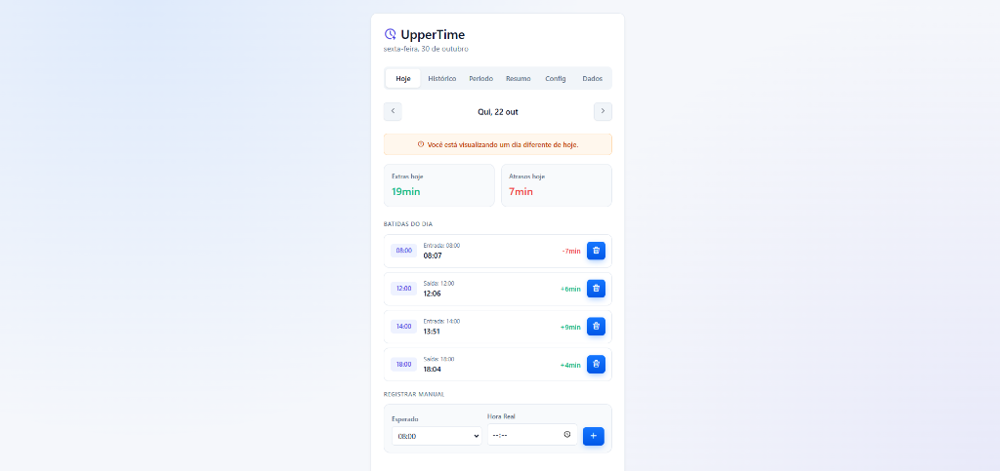
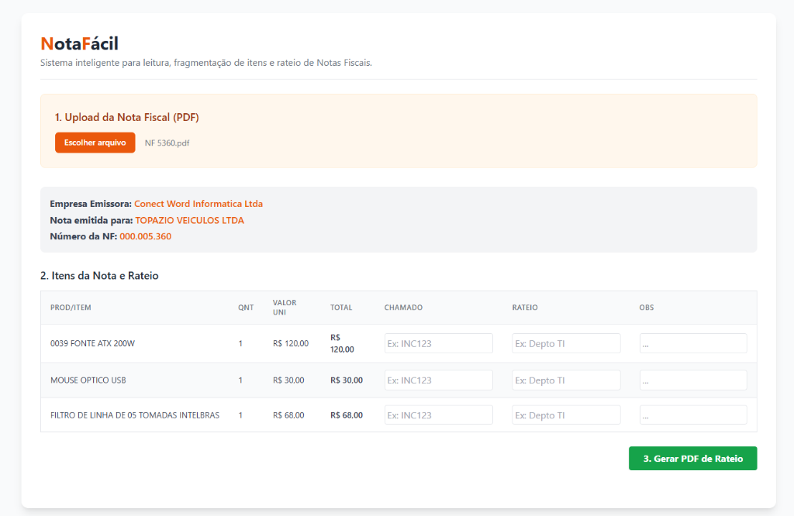

# Daniel Martins
### **Analista de TI & Desenvolvedor Full Stack | Automação com IA**

[-059669?style=for-the-badge&logo=googletranslate&logoColor=white)](#)

  

---

## Sobre Mim

Sou graduando do **8º semestre de Sistemas de Informação** na Faculdade UniFTC e atuo como **Analista de T.I no Grupo Itadil**. Possuo sólida experiência em infraestrutura corporativa, diagnóstico e resolução de falhas, suporte a sistemas críticos e otimização de fluxos operacionais por meio de desenvolvimento de software e inteligência artificial.

- **Foco de Atuação:** Construção de aplicações web robustas, dashboards analíticos para gestão, arquiteturas em nuvem e automação de processos corporativos com uso estratégico de IA e engenharia de prompts.
- **Experiência Corporativa:** Atuação direta em ambientes operacionais e corporativos de alta demanda, alinhando suporte técnico avançado, governança e desenvolvimento de ferramentas customizadas.
- **Idiomas:** Inglês Avançado (**C1** - apto para comunicação técnica e ambientes globais) e Espanhol Básico (**A2**).
- **Competências:** Pensamento analítico, perfil orientador de resultados, proatividade, relacionamento comercial e resolução estratégica de problemas.

---

## Projetos em Destaque

---

### 1. Nexus360 - Gestão Integrada de Estoque e WMS

> **Sistema corporativo moderno para gestão de estoques de alta rotatividade, controle de perdas e automação logística para redes de varejo e centros de distribuição.**

  
  
<em>Painel Principal: KPIs operacionais em tempo real, produtos vencidos, estoques críticos e navegação integrada entre módulos.</em>

 

<table width="100%">
  <tr>
    <td width="50%" valign="top">
      <h4 align="center">Controle e Rastreabilidade de Lotes</h4>
      
      
Rastreabilidade ponta a ponta (Produto, NF, Lote, Validade e classificação de risco).

    </td>
    <td width="50%" valign="top">
      <h4 align="center">Entrada de Mercadorias</h4>
      
      
Recebimento físico vinculado a Fornecedor, NF e geração instantânea de lote com validade.

    </td>
  </tr>
  <tr>
    <td width="50%" valign="top">
      <h4 align="center">Saída de Mercadorias (Algoritmo FEFO)</h4>
      
      
Baixas inteligentes priorizando lotes de menor vencimento para erradicar perdas no varejo.

    </td>
    <td width="50%" valign="top">
      <h4 align="center">Relatórios Gerenciais e Indicadores</h4>
      
      
Métricas analíticas de Curva ABC, taxa de ruptura, histórico de movimentações e cálculo de perdas.

    </td>
  </tr>
  <tr>
    <td colspan="2" width="100%" valign="top">
      <h4 align="center">Controle de Usuários e Permissões (RBAC)</h4>
      
      
Gestão de acessos por perfil (Administrador, Gerente, Operador) e escopo de visualização por loja física ou matriz.

    </td>
  </tr>
</table>

- **Problema Solucionado:** Erradicação de prejuízos operacionais decorrentes de produtos vencidos nas gôndolas e otimização dos fluxos de reposição entre filiais e centros de distribuição.
- **Destaques Técnicos:**
  - **Algoritmo FEFO (First Expired, First Out):** Automação total nas baixas e separações priorizando os lotes mais próximos da data de expiração, com trava automática para lotes vencidos.
  - **Arquitetura Multi-Unidades:** Gestão unificada com segregação física entre Centros de Distribuição (CDs) e Lojas, com solicitações e transferências atômicas.
  - **Segurança Corporativa (RBAC + RLS):** Controle de permissões baseado em funções corporativas com *Row Level Security* nativo no PostgreSQL.
  - **Métricas Analíticas:** Painéis de curva ABC, cálculo de risco financeiro em estoque e sugestões automáticas de reposição.
- **Stack:** `Next.js 14`, `React`, `TypeScript`, `Tailwind CSS`, `Supabase (PostgreSQL / RLS)`.

[Repositório do Nexus360](https://github.com/danmrtx/nexus360)

---

### 2. UpperTime - Rastreador Inteligente de Horas Extras CLT

> **Progressive Web App (PWA) para acompanhamento preciso de jornadas de trabalho, cálculo automático de minutos extras/atrasos e gestão de banco de horas.**

  

- **Problema Solucionado:** Eliminação de divergências e falta de previsibilidade no fechamento mensal da folha de pagamento para profissionais em regime CLT e prestadores flexíveis.
- **Destaques Técnicos:**
  - **Batida Instantânea com Cálculo de Delta:** Apuração em tempo real de minutos adicionais ou atrasos em relação à escala de trabalho prevista.
  - **Configurações Individuais de Jornada:** Personalização completa de escalas diárias, incluindo diferenciação para sábados e domingos.
  - **Instalação Nativa (PWA):** Execução independente no navegador mobile (iOS e Android) ou desktop, operando com agilidade e design responsivo.
  - **Sincronização em Nuvem e Exportação:** Persistência segura em nuvem e exportação dos dados estruturados em formato CSV/Excel.
- **Stack:** `JavaScript (ES6+)`, `HTML5 & CSS3`, `PWA / Service Workers`, `Vercel Serverless Functions`, `Supabase`.

[Repositório do UpperTime](https://github.com/danmrtx/UpperTime)

---

### 3. NotaFácil - Extrator de Danfe e Rateio Contábil de Notas Fiscais

> **Ferramenta client-side para processamento inteligente de PDFs de Danfe, fragmentação unitária de itens e geração de relatórios de rateio.**

  

- **Problema Solucionado:** Automação do trabalho manual nas áreas de TI e Controladoria na conferência de faturas fiscais com múltiplos itens para alocação de centros de custo e chamados.
- **Destaques Técnicos:**
  - **Processamento 100% Client-Side:** Execução direta no navegador via JavaScript, garantindo custo zero de infraestrutura e sigilo absoluto sobre dados fiscais da empresa.
  - **Fragmentação Unitária de Produtos:** Decomposição automática de itens com quantidade múltipla em registros unitários, permitindo a correlação de diferentes chamados e centros de custo ao mesmo código de produto.
  - **Geração de Relatórios em PDF:** Criação instantânea de documento PDF formatado com dados da nota, detalhes dos itens e rateios preenchidos para validação contábil.
- **Stack:** `JavaScript`, `Tailwind CSS`, `PDF.js`, `jsPDF / AutoTable`.

[Repositório do NotaFácil](https://github.com/danmrtx/NotaFacil)

---

## Tecnologias e Habilidades

<table>
  <tr>
    <td valign="top" width="25%">
      <h4>Frontend</h4>
       
       
       
       
       
       
      
    </td>
    <td valign="top" width="25%">
      <h4>Backend e Dados</h4>
       
       
       
       
      
    </td>
    <td valign="top" width="25%">
      <h4>IA e Automação</h4>
       
       
       
      
    </td>
    <td valign="top" width="25%">
      <h4>Infraestrutura e Ferramentas</h4>
       
       
       
       
      
    </td>
  </tr>
</table>

---

## Estatísticas do GitHub

  
  

  

---

  Daniel Martins | Analista de TI e Desenvolvedor

